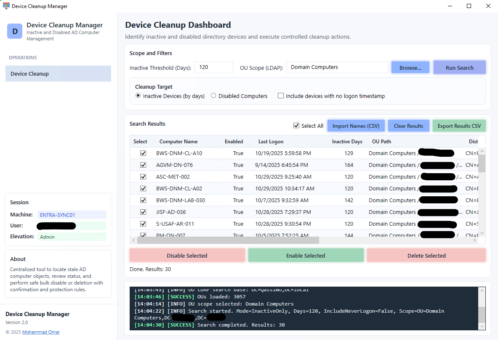

<div align="center">

# 🧹 Device Cleanup Manager

**Active Directory computer cleanup, safely**

Find inactive and disabled computer accounts, then disable, enable, or delete them in bulk. Confirmation prompts and protected-OU rules guard the destructive actions.

[](#-usage)
[](https://learn.microsoft.com/en-us/powershell/)
[](#%EF%B8%8F-requirements)
[](#%EF%B8%8F-usage)
[](#-overview)
[](#-license)
[](#-overview)

[Overview](#-overview) • [Features](#-core-features) • [Usage](#-usage) • [Requirements](#%EF%B8%8F-requirements) • [Troubleshooting](#-troubleshooting) • [License](#-license)

</div>

---

# 📖 Overview

Device Cleanup Manager is a WPF tool for managing Active Directory computer objects. It can:

* Find inactive devices using `LastLogonDate` and a configurable Days Inactive value
* Find disabled computers where `Enabled = False`
* Limit a search to one OU, picked from a searchable browser, or to the whole domain
* Read a list of device names from CSV
* Disable, enable, or delete the selected devices after confirmation and protected-OU checks
* Export the results to CSV and show each step in a live Message Center

---

## 🖼️ Screenshots



*Main window with the search mode controls, OU scope, results grid, and Message Center.*

---

# ✨ Core Features

### 🔹 Search Modes
* Inactive Devices by days: compares `LastLogonDate` with a cutoff date. You can include devices that have no logon timestamp
* Disabled Computers: uses the server-side filter `Enabled -eq $false`

### 🔹 OU Scope Selector
* An LDAP picker with a search box for finding OUs
* Search the entire domain or one OU

### 🔹 Results Dashboard
A grid with a checkbox on each row and a Select All option. Columns: Computer Name, Enabled, Last Logon Date, Inactive Days, OU Path, Distinguished Name, and Source (Search or CSV).

### 🔹 Bulk Actions
The actions apply to checked rows:

| Action | Protected By |
|---|---|
| **Disable Selected** | Confirmation dialog and protected DN rules |
| **Enable Selected** | Confirmation dialog and protected DN rules |
| **Delete Selected** | Confirmation dialog and protected DN rules |

Objects under a protected OU or DN are skipped before the action runs.

### 🔹 CSV Import (Bulk List Mode)
Import a names-only list. The CSV can use `ComputerName` or `Name` as its header.

```csv
ComputerName
PC-001
PC-002
LAB-010
```

Imported rows are marked `Source = CSV`. If the DN is missing, the tool looks the device up in AD when the action runs.

### 🔹 Export & Message Center
* Export results to CSV with ComputerName, Enabled, LastLogonDate, InactiveDays, OUPath, DistinguishedName, and Source
* A live log at INFO, SUCCESS, WARNING, and ERROR level covers searches, scope changes, imports, exports, action results, and LDAP or RSAT errors

---

# 📂 Project Structure

```text
Device-Cleanup-Manager/
│
├── DeviceCleanupManager.ps1      # WPF application source
├── DeviceCleanupManager.exe      # Packaged executable
├── Screenshot.png                # Documentation screenshot
└── README.md
```

---

# 🚀 Usage

### Launch

**Option 1 — PowerShell script:**

```powershell
Set-ExecutionPolicy Bypass -Scope Process -Force
.\DeviceCleanupManager.ps1
```

**Option 2 — Packaged EXE (self-signed with PSWrap):**

```text
DeviceCleanupManager.exe
```

The EXE was compiled and self-signed with [PSWrap](https://github.com/mabdulkadr/PSWrap), so it runs without a PowerShell console.

### Typical Workflow

1. Launch the tool
2. Pick a mode: Inactive Devices with a day count, or Disabled Computers
3. Pick the OU scope. Use Browse to search for an OU
4. Click **Run Search**
5. Review the results and check the devices you want to act on
6. Run Disable, Enable, or Delete on the selection
7. Export the results if you need a record

---

# ⚙️ Requirements

| Requirement | Details |
|-------------|---------|
| **OS** | Windows 10 / 11 |
| **Domain** | Connectivity to a domain controller is recommended |
| **Elevation** | Run as Administrator when your role requires it |
| **Module** | `ActiveDirectory` (RSAT) |

Install RSAT on Windows 10 or 11:

```powershell
Add-WindowsCapability -Online -Name Rsat.ActiveDirectory.DS-LDS.Tools~~~~0.0.1.0
```

### Data & Logs

```text
C:\ProgramData\DeviceCleanupManager\
└── Logs\
```

---

# 🧠 Inactivity Logic

The tool runs `Get-ADComputer ... -Properties LastLogonDate`. That value comes from the replicated `lastLogonTimestamp`:

* It works for cleanup reports and for finding stale objects
* It is not a live "last logon across all DCs" figure. A recently active device can appear behind by up to the replication tolerance

---

# 🔍 Troubleshooting

| Symptom | Likely Cause | Fix |
|---------|--------------|-----|
| OU list doesn't load | No domain connection or no LDAP access | Check domain connectivity and firewall rules |
| "RSAT module not found" | ActiveDirectory module missing | Install RSAT with `Add-WindowsCapability` (see Requirements) |
| Search returns no results | Day count too low or wrong OU scope | Raise Days Inactive or select Entire Domain |
| Delete or Disable fails | Protected DN rule or insufficient rights | Check protected OUs and delegated AD permissions |
| CSV import shows empty | Wrong column header | Use `ComputerName` or `Name` |

---

# 🛡 Operational Notes

* The tool checks for RSAT before AD work, asks for confirmation on destructive actions, applies protected DN rules, and refreshes the grid safely afterwards
* Review the protected DN rules before your first Delete run. They are the main safeguard
* Try a Disable pass on a pilot OU before deleting anything. A disabled account can be re-enabled; a deleted one needs AD Recycle Bin or a restore
* Delegate only the rights the job needs, such as deleting computer objects in target OUs. Domain Admin is not required
* Export results before and after each action. The Message Center log records the session

---

## 👤 Author

**Mohammad Abdelkader Omar**  
GitHub: [@mabdulkadr](https://github.com/mabdulkadr)  
Website: [momar.tech](https://momar.tech)  

---

## 📜 License

This project is licensed under the [MIT License](LICENSE).

---

## ⚠ Disclaimer

This skill and every script it generates are provided as-is with no warranty
of any kind. Test generated tools in a staging environment before deploying to
production. The authors assume no liability for any damage or data loss
resulting from their use.

---
<div align="center">

⭐ **If this tool saves you time, star the repo — it helps others find it.**

[Report an Issue](../../issues) · [momar.tech](https://momar.tech)

[](https://www.buymeacoffee.com/mabdulkadrx)

Built with [**PowerShell Enterprise Admin**](https://github.com/mabdulkadr/powershell-enterprise-admin-skill)

</div>
